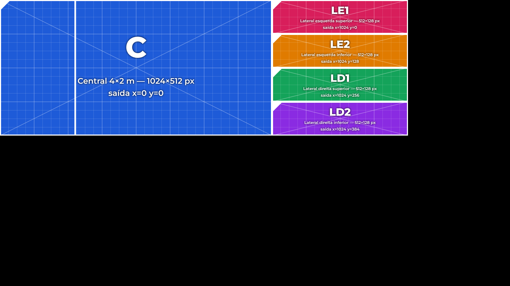

# Evangelizashow — painel de LED

Player do que passa no painel de LED durante o Evangelizashow da Comunidade SIM
(sábado, 21/11, 19h30). Roda no navegador (Chrome ou Edge), sem internet e sem
programa pago.

## O painel

Painel P3.91 → **256 pixels por metro**.

| Tela | Tamanho | Pixels | Posição na saída (x, y) |
|---|---|---|---|
| C — central | 4 × 2 m | 1024 × 512 | 0, 0 |
| LE1 — lateral esquerda superior | 2 × 0,5 m | 512 × 128 | 1024, 0 |
| LE2 — lateral esquerda inferior | 2 × 0,5 m | 512 × 128 | 1024, 128 |
| LD1 — lateral direita superior | 2 × 0,5 m | 512 × 128 | 1024, 256 |
| LD2 — lateral direita inferior | 2 × 0,5 m | 512 × 128 | 1024, 384 |

O notebook manda **uma saída Full HD (1920 × 1080)** para o processador do painel,
com as 5 telas montadas assim (o resto da imagem fica preto):

**Para o técnico do painel:** configure no processador (Novastar etc.) cada tela
recortando a região da tabela acima. Para conferir, aperte **T** no player: aparece
o padrão de teste com o nome de cada tela. Cada tela tem que mostrar o nome certo,
com o triângulo branco no canto superior esquerdo, e a barra branca tem que
atravessar os 9 m da esquerda para a direita, sem pular.

Se ele preferir outra arrumação, basta mudar os valores de `saida` em `config.js`.

## Como usar no dia

1. Copie a pasta `evangelizashow` inteira para o notebook.
2. Ligue o painel como **segunda tela estendida** do notebook, em 1920 × 1080.
3. Abra `controle.html` no Chrome e clique em **Abrir saída do painel**.
4. Arraste a janela da saída para a tela do painel e dê **duplo clique** para
   colocar em tela cheia.
5. Opere pelo controle, que fica no notebook, ou pelo teclado ou passador de slides:

| Tecla | Ação |
|---|---|
| → · Espaço · PageDown | avançar (passa a letra linha por linha, depois vai para a próxima cena) |
| ← · PageUp | voltar |
| ↓ / ↑ | pular para a próxima cena / voltar para a anterior |
| B ou . | tela preta (com fade) |
| T | padrão de teste |
| P | prévia do palco na saída, para ver como fica |
| L / V / C | vinheta do logo: explosão / revelação / cortina |
| R / X | raios de luz saindo do centro / relâmpagos dourados |
| F | liga e desliga o logo correndo nas laterais, alternado com "30 anos SIM" |
| K | tap tempo: bata 3 vezes ou mais no ritmo da música |

Também dá para clicar direto numa cena ou numa linha de letra no controle.

> **Windows com escala de tela (125%, 150%)**: a saída já compensa isso para manter
> 1 pixel = 1 LED. Mesmo assim, deixe a escala da tela do painel em 100%, se der.

## Editando o roteiro

O roteiro fica em `roteiro.js`, e cada cena é um bloco. O começo do arquivo explica
todos os campos. Os principais são:

- `titulo` / `subtitulo`: no título, `*palavra*` sai em itálico dourado, como o
  "App *SIM*" da identidade;
- `letras`: lista de slides, com `\n` para quebrar a linha;
- `fundo`: um efeito animado (`sim`, `raios`, `particulas`, `estrelas`, `ondas`,
  `gradiente`, `preto`) ou um vídeo/imagem da pasta `midia/`;
- `faixa`: texto que corre nas tiras laterais, onde `{logo}` vira o logo correndo junto
  (ex.: `'{logo}   30 anos SIM   '`);
- `contagem`: relógio regressivo, por exemplo `{ ate: '19:30' }`.

## Efeitos de show e vinhetas

Os efeitos de show **pulsam na batida da música**. O roteiro começa em 120 BPM e,
durante o show, o operador acerta o ritmo batendo **K** junto com a música (ou no
botão *Tap tempo*). Tudo fica nas cores da identidade: azul, dourado e creme.

| Fundo | O que faz |
|---|---|
| `varredura` | fachos de luz varrendo o palco, como moving heads |
| `pulso` | anéis saindo do centro a cada batida; as tiras acendem uma por vez |
| `feixes` | barras de luz correndo pelos 9 m (o desenho muda a cada 8 batidas) |
| `tunel` | molduras douradas vindo do centro para fora |
| `brilhos` | chuva de brilho dourado |

| Vinheta | O que faz |
|---|---|
| `explosao` (L) | clarão, onda de choque e faíscas, com o logo surgindo no centro |
| `revelacao` (V) | um facho de luz atravessa o palco e revela o logo e "Evangeliza*show*" |
| `cortina` (C) | barras douradas cobrem o painel, o logo aparece e as barras abrem a cena |
| `raios` (R) | raios de luz saem do centro até as laterais (passam por trás da letra) |
| `relampago` (X) | três relâmpagos dourados atravessam o palco (passam por trás da letra) |

Para uma vinheta disparar sozinha durante a música, use na cena
`automatico: { vinheta: 'raios', aCada: 16 }`, que dispara a cada 16 batidas.

As vinhetas podem ser disparadas a qualquer momento, ou usadas como **passagem**
entre cenas com `entrada: 'cortina'` (ou outra) na cena. Nesse caso, a troca de
cena acontece por baixo da vinheta.

Nenhum efeito pisca a tela inteira em ritmo rápido. Mesmo assim, evite subir o
BPM muito acima de 150 no `pulso` e nos `feixes`.

## Imagens nas músicas de oração

Use uma galeria: `fundo: { imagens: ['midia/a.jpg', 'midia/b.jpg'], troca: 12 }`.
As imagens trocam a cada 12 segundos com fade, um zoom bem lento e a própria imagem
desfocada preenchendo o resto do palco. Retratos e banners aparecem inteiros, sem
corte. Nessas cenas, o título e a letra vão para a parte de baixo do painel, para não
cobrir rostos.

Para cartazes que já têm texto, como o "Diga SIM a Deus", use uma cena só com a imagem,
sem título nem letra.

### Arte dos santos ("Testemunhas do *SIM*")

A cena **Santos (arte)** usa o fundo `mosaico`: retratos lado a lado em molduras
douradas, entrando um a um do centro para as pontas, com o nome embaixo. As fotos
ficam em `midia/santos/`, já recortadas e tratadas no duotom azul da identidade.
Para trocar ou acrescentar um santo, mande a foto que eu trato do mesmo jeito.
A arte parada também está em `artes/testemunhas-do-sim-1024x512.png`.

## Vídeos e imagens

Coloque os arquivos em `midia/` e use na cena, por exemplo
`fundo: { video: 'midia/abertura.mp4', modo: 'panorama' }`.

| Modo | Tamanho do arquivo | Onde aparece |
|---|---|---|
| `panorama` | **2304 × 512** | os 9 m inteiros (o player recorta cada tela) |
| `central` | **1024 × 512** | só no painel central; as laterais ficam com um efeito |
| `mapeado` | **1920 × 1080** | arquivo já montado no mapa de pixels da saída |

Para quem for criar arte no Canva ou em outro programa, os gabaritos estão em
`gabaritos/`. O `palco-panorama-2304x512.png` mostra onde cada tela cai dentro
do panorama de 9 m. As áreas pretas entre as telas são refletores e não aparecem.

Use vídeo MP4 (H.264), sem áudio, de preferência em loop.

## Identidade visual

As cores, as fontes (Playfair Display e Montserrat, salvas em `fontes/`) e o logo
(`midia/logo.png`) seguem o material da Comunidade SIM.
